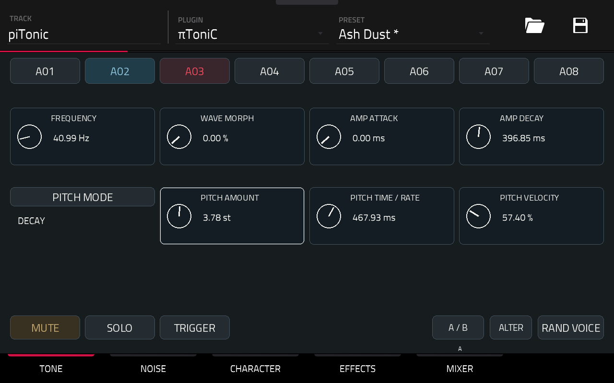
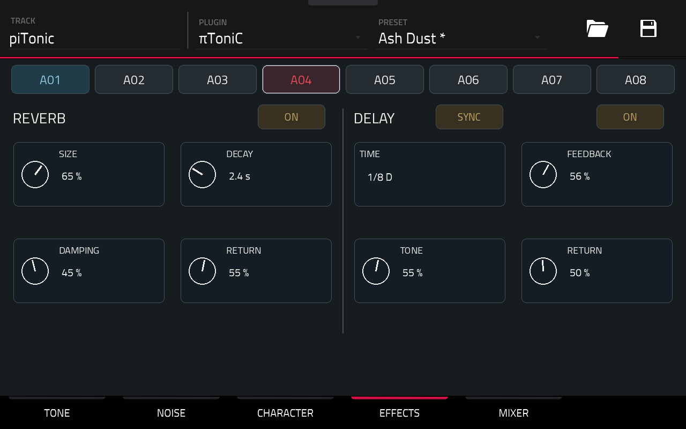

# πToniC

An eight-voice percussion synthesizer for MPC OS, with native touch controls, per-voice sound design and shared reverb and delay.

Build a kit, play it from the pads, and sequence it with the Force's own Step Sequencer. πToniC produces audio directly; it has no internal pattern sequencer.

## Features

- Eight independent voices on MIDI notes 36–43.
- Oscillator morphing, amplitude and pitch envelopes, sine/random pitch modulation.
- Filtered noise with EXP, LINEAR and CLAP envelopes; optional independent stereo noise.
- Per-voice drive, EQ, velocity response, pan and choke groups.
- A/B sound comparison, subtle ALTER and full RAND VOICE variation.
- Eight-channel mixer with mute, solo and individual reverb/delay sends.
- Shared stereo reverb and a tempo-synchronised or free-time delay.
- Five touch pages, contextual Q-Links and azure trigger activity.
- 150 converted Patternarium BEST kits in the native PRESET menu.
- Native preset and project-state storage, including edited sounds and effects.

## Download and install

[Download πToniC 1.0.0 for Gen1 ARMv7](https://github.com/timomacquis/piToniC-MPC/releases/tag/v1.0.0).

The release package is **piToniC-1.0.0-Patternarium-BEST150-mpc-armv7.zip**.

This build targets **Gen1 ARMv7** devices with MPC OS 3.x and standalone VST support. Hardware use has been on an Akai Force running OS 3.10.0.49. A 64-bit Gen2 package is not provided.

See [Installation and removal](docs/INSTALLATION.md).

## Play

On Force, use **SHIFT + STEP SEQUENCER → Chromatic → Snap to Scale: On**, and check that the starting note is 36. A01–A08 then trigger the eight voices in order.

Factory sends start at zero. Raise a REVERB or DELAY send in MIXER, then adjust its return on EFFECTS.

[User manual](docs/USER-MANUAL.md) · [Mode d’emploi français](docs/MODE-EMPLOI.md)

## Development

[Build from source](docs/BUILD.md) · [Engine and implementation](docs/IMPLEMENTATION.md)

## Credits and licence

πToniC by Timo. The engine and integration are released under the MIT licence, with third-party notices preserved.

Voice and effects architecture draws on WeirdDrums by Daniele Filaretti and Weird Dreams by Vincent Fillion. The MPC wrapper and packaging tools originate from the Open MPC project. Titillium Web is distributed under the SIL Open Font License.

The 150 factory kits are converted parameter recipes from the Patternarium Best of Generation G04–G28 collection. Original generated sounds: Sonic Charge / Patternarium. Attribution and selection provenance accompany the bank. The engine is independent and does not claim identical sound to Microtonic.

See [THIRD-PARTY.md](THIRD-PARTY.md) and the package's PATTERNARIUM-CREDITS.md. No Microtonic factory preset bank or proprietary DSP is included.

Unofficial community software; not affiliated with Akai, inMusic or Sonic Charge.
