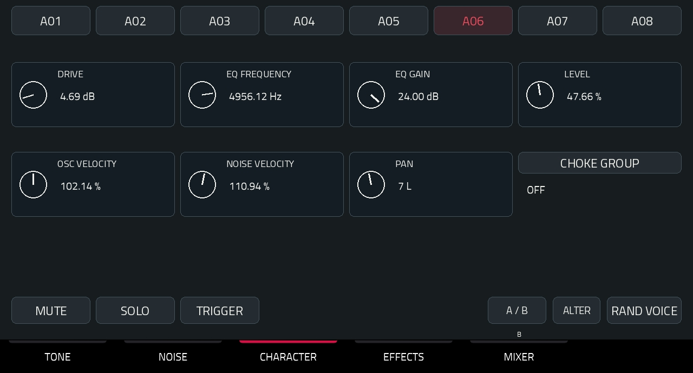
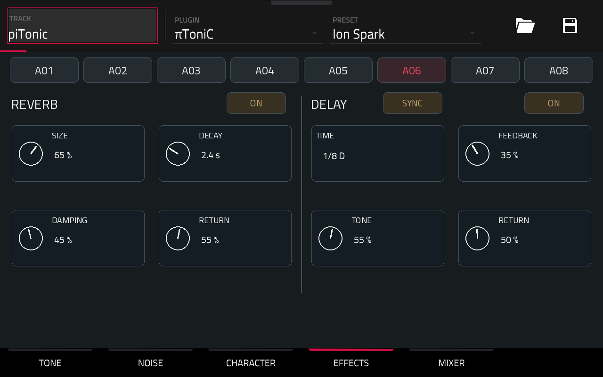

# πToniC

A Microtonic-inspired drum machine.

πToniC features 8 independent drum voices, each combining filtered noise with a morphing oscillator or WAV sample playback.

Its sound engine includes pitch modulation, amplitude envelopes, drive, EQ and individual voice controls.

Shared stereo reverb and tempo-synced delay complete the engine.

## Features

- Compact selection panels over the dimmed current screen, amber opening selectors and 36 px panel buttons.
- Shared colour charter: blue outline for selectors without a neutral value, amber once CHOKE or STEREO NOISE leaves OFF, gold sample waveform.

- Per-voice SYNTH / SAMPLE source with mono/stereo WAV loading (up to ten seconds).
- TUNE and START controls, waveform overview and contextual SAMPLE Q-Links.
- Samples keep their original paths; no audio is embedded in presets or projects.

- Eight independent voices on MIDI notes 36–43.
- Oscillator morphing, amplitude and pitch envelopes, sine/random pitch modulation.
- Filtered noise with EXP, LINEAR and CLAP envelopes; optional independent stereo noise.
- Per-voice drive, EQ, velocity response, pan and choke groups.
- A/B sound comparison, subtle ALTER and full RAND VOICE variation.
- Eight-channel mixer with mute, solo and individual reverb/delay sends.
- Shared stereo reverb and a tempo-synchronised or free-time delay.
- Five touch pages, contextual Q-Links and azure trigger activity.
- 150 converted Patternarium BEST kits in the native PRESET menu.
- Native preset and project-state storage, including edited sounds and effects.

## Download and install

πToniC **1.1.2** — [release v1.1.2](https://github.com/timomacquis/piToniC-MPC/releases/tag/v1.1.2):

| Device generation | Download |
| --- | --- |
| **Gen1 / Force** (ARM32) and **Gen2** (ARM64, not tested on hardware) | [piToniC-1.1.2-mpc-sdk.zip](https://github.com/timomacquis/piToniC-MPC/releases/download/v1.1.2/piToniC-1.1.2-mpc-sdk.zip) |

Unzip, copy the folder **`Timo - VST - πToniC`** into **`VST2 Plugins`** at the root of a drive (User Memory: `/sdcard/VST2 Plugins`), then restart MPC. This is the installation method defined by Akai's plugin SDK: no installer script, no `Synths` folder, no MPC.settings entry. Requires MPC OS 3.10.1+ with Enhancements and External Plugin Support enabled. Hardware use: Akai Force.

See [Installation and removal](docs/INSTALLATION.md).

## Play

On Force, use **SHIFT + STEP SEQUENCER → Chromatic → Snap to Scale: On**, and check that the starting note is 36. A01–A08 then trigger the eight voices in order.

Factory sends start at zero. Raise a REVERB or DELAY send in MIXER, then adjust its return on EFFECTS.

[User manual](docs/USER-MANUAL.md) · [Mode d’emploi français](docs/MODE-EMPLOI.md)

## Development

[Build from source](docs/BUILD.md) · [Engine and implementation](docs/IMPLEMENTATION.md)

## Credits and licence

πToniC by Timo. The engine and integration are released under the MIT licence, with third-party notices preserved.

Voice and effects architecture draws on WeirdDrums by Daniele Filaretti and Weird Dreams by Vincent Fillion. The MPC wrapper and packaging tools originate from the Open MPC project. Titillium Web is distributed under the SIL Open Font License.

The 150 factory kits are converted parameter recipes from the Patternarium Best of Generation G04–G28 collection. Original generated sounds: Sonic Charge / Patternarium. Attribution and selection provenance accompany the bank. The engine is independent and does not claim identical sound to Microtonic.

See [THIRD-PARTY.md](THIRD-PARTY.md) and the bank's NAMES.md / CONVERSION-REPORT.json. No Microtonic factory preset bank or proprietary DSP is included.

Unofficial community software; not affiliated with Akai, inMusic or Sonic Charge.
