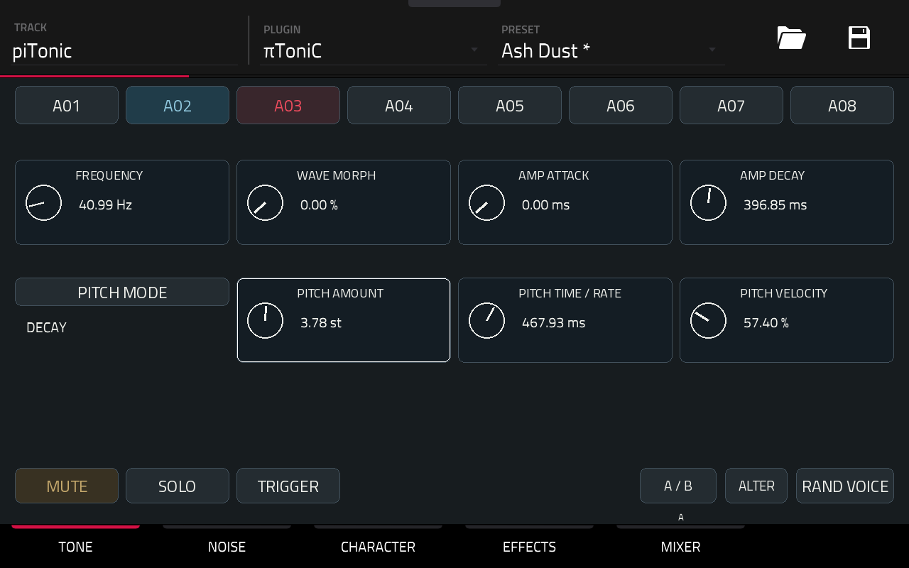
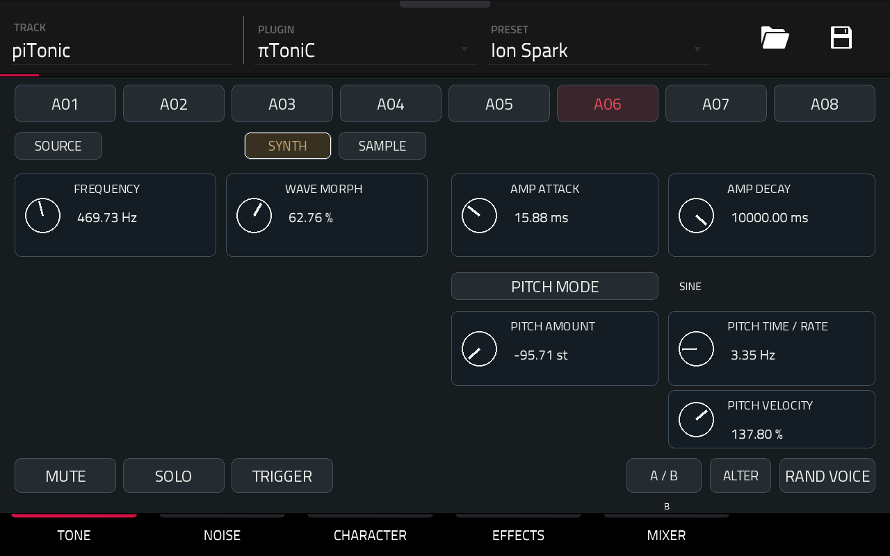
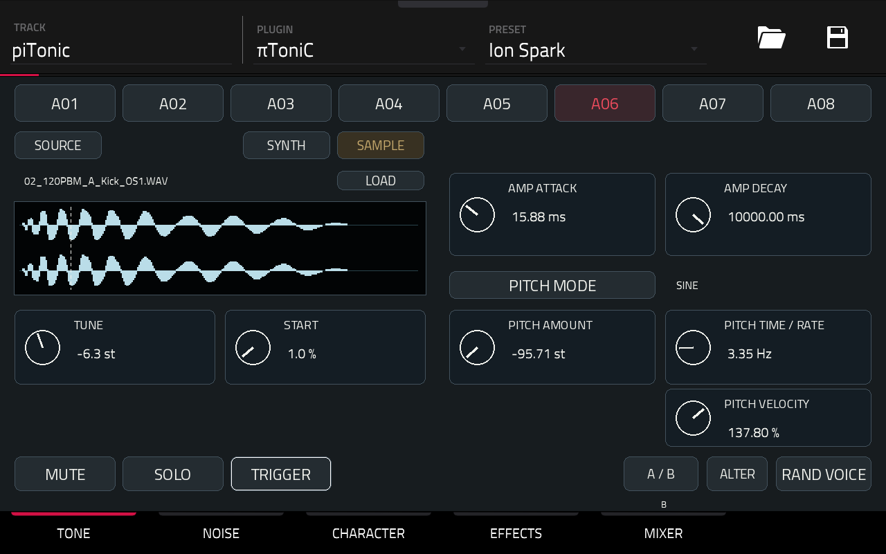
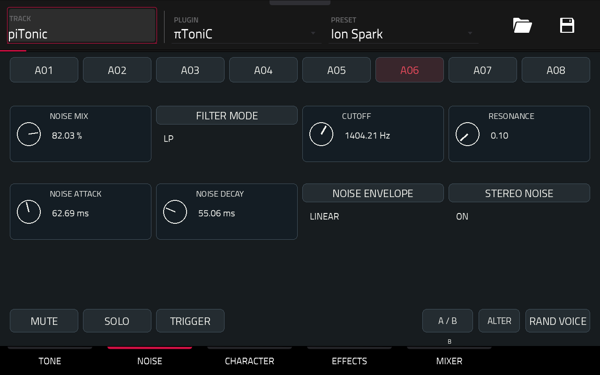
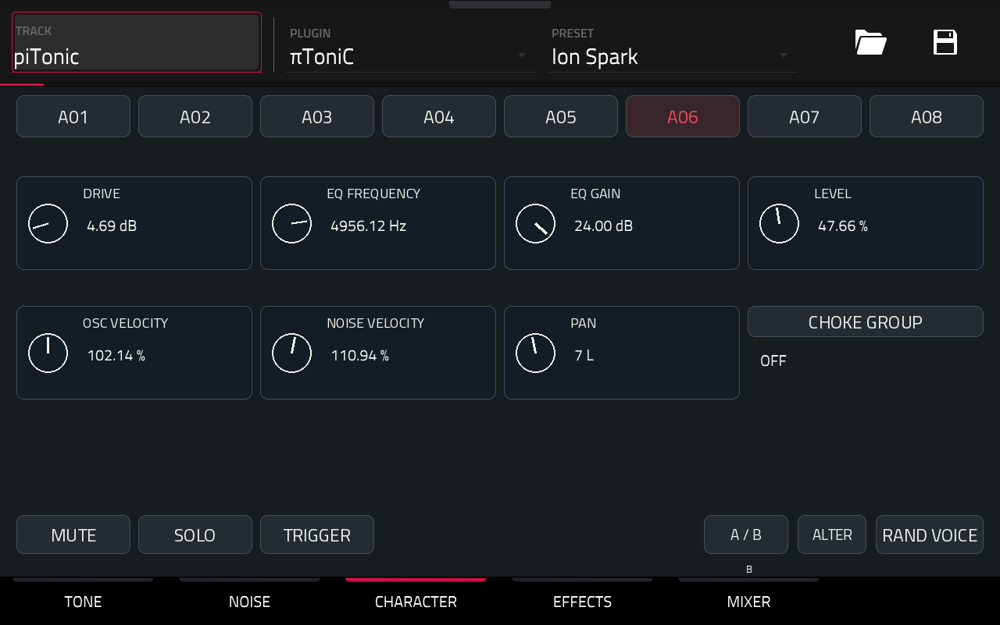
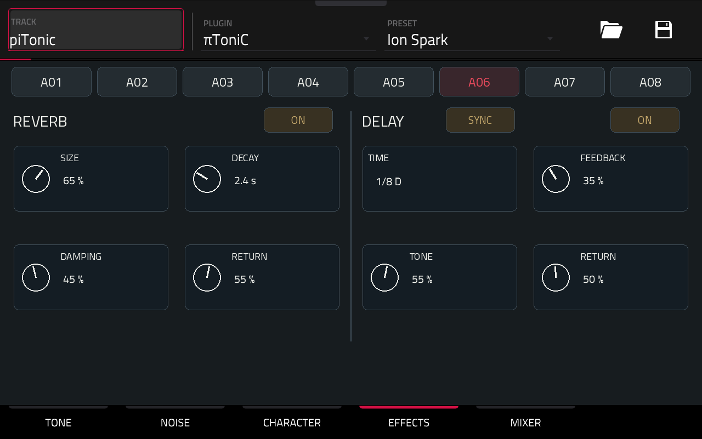
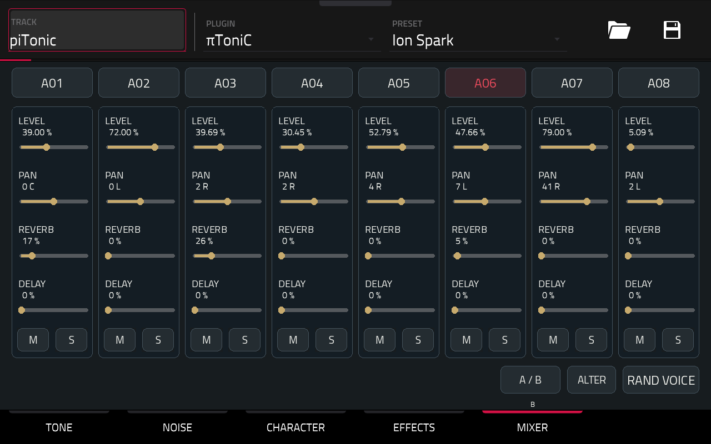

# πToniC — mode d’emploi

Une boîte à rythmes inspirée de Microtonic.

πToniC propose 8 voix de percussion indépendantes, chacune associant du bruit filtré à un oscillateur à forme variable ou à la lecture d’un sample WAV.

Son moteur sonore réunit modulation de hauteur, enveloppes d’amplitude, drive, EQ et réglages individuels par voix.

Une reverb stéréo et un delay synchronisé au tempo complètent le moteur.

Explorez **150 presets de kits Patternarium BEST convertis**, puis faites-les vôtres.

## Jouer et séquencer

Jouez les huit voix avec les notes MIDI **36–43** : A01 à A08. Les notes 0–7 sont aussi acceptées sur le chemin DRUM compatible.

Vous pouvez jouer une voix tout en en réglant une autre.

Composez avec le **Step Sequencer de la Force**.

Pour retrouver A01–A08 sur les notes 36–43 :

**SHIFT + STEP SEQUENCER → Scale : Chromatic → Snap to Scale : activé.**

Vérifiez aussi le registre de départ.

TRIGGER permet d’écouter la voix sélectionnée. Les enveloppes déterminent la durée des sons ; relâcher la note ne coupe pas le hit.

## Sélection et activité

Touche A01–A08 pour choisir une voix. La voix sélectionnée est rouge. Le contour blanc fin suit le contrôle qui a le focus pour la molette.

Une impulsion azur marque un déclenchement accepté. Une voix exclue par MUTE ou SOLO ne produit pas cette impulsion.

A02 joue : son bouton s’illumine en azur, tandis qu’A03 reste sélectionnée pour l’édition.

## TONE

Choisissez **SYNTH** pour créer un son, ou **SAMPLE** pour partir d’un WAV. Chaque voix fait son propre choix.

### SYNTH — façonnez une percussion

- **FREQUENCY** : fréquence de l’oscillateur.
- **WAVE MORPH** : transition sinus → triangle → dent de scie → carré.
- **AMP ATTACK / DECAY** : attaque et décroissance de l’amplitude.
- **PITCH MODE** : enveloppe DECAY, modulation SINE ou RANDOM.
- **PITCH AMOUNT** : excursion de hauteur, positive ou négative.
- **PITCH TIME / RATE** : durée en ms en mode DECAY, vitesse en Hz en SINE / RANDOM.
- **PITCH VELOCITY** : influence de la vélocité sur la modulation de hauteur.

La vitesse effective du mode SINE est limitée à 2 000 Hz.

### SAMPLE — partez d’un son

Un kick enregistré ? Une texture ? Un bruit trouvé ?

Choisissez **SAMPLE**, puis **LOAD** et touchez votre fichier WAV.

**USER / SD** et **DRIVES** choisissent le support. **UP** remonte d’un dossier ; **PREVIOUS / NEXT** changent de page. **CANCEL** ferme le navigateur.

WAV mono ou stéréo, **10 secondes maximum** : PCM 16/24/32 bits ou float32, de 8 à 192 kHz. Le navigateur affiche jusqu’à 256 entrées par dossier.

**TUNE** monte ou descend le son, jusqu’à ±48 demi-tons. À zéro, il joue à sa vitesse d’origine. Plus aigu, il devient aussi plus court.

**START** choisit où commencer, en pourcentage du fichier entier.

Chaque note relance le sample : lecture unique, sans boucle ni time-stretch.

L’enveloppe **AMP**, la modulation de hauteur, le bruit et les effets restent à votre disposition. Essayez un sample court avec un peu de bruit : une nouvelle percussion se dessine.

### Lire le LCD

Une onde en mono. Deux en stéréo.

L’écran cadre la partie sonore et laisse une petite marge après sa fin. Le silence initial est conservé ; le fichier et sa lecture ne changent pas.

Le **trait pointillé** indique START. Si le départ dépasse la partie affichée, il reste au bord droit.

L’onde est préparée au chargement, puis gardée en cache. Une erreur de chargement apparaît à la place du nom de fichier.

### Retrouvez vos sons

**A / B** garde deux réglages TUNE/START pour le même fichier. **ALTER** et **RAND VOICE** gardent le sample, mais font varier ses réglages.

Les deux premiers Q-Links deviennent **TUNE et START**. Repassez en SYNTH : ils retrouvent **FREQUENCY et WAVE MORPH**.

**Les presets et projets retiennent le chemin du sample, pas le son lui-même.** Gardez vos fichiers au même endroit. La copie automatique près du preset n’est pas encore disponible.

## NOISE

- **NOISE MIX** : équilibre oscillateur / bruit.
- **FILTER MODE** : LP, BP ou HP ; **CUTOFF / RESONANCE** façonnent le bruit.
- **NOISE ATTACK / DECAY** : enveloppe du bruit.
- **NOISE ENVELOPE** : EXP, LINEAR ou CLAP.
- **STEREO NOISE** : bruits indépendants à gauche et à droite ; OFF conserve un bruit commun.

## CHARACTER

Un peu de mordant ? Montez **DRIVE**.

Pour changer la couleur, jouez avec **EQ FREQUENCY / GAIN**.

**LEVEL, OSC VELOCITY, NOISE VELOCITY et PAN** règlent le niveau, les sensibilités à la vélocité et le panoramique.

Les voix d’un même **CHOKE GROUP** se coupent mutuellement. OFF les laisse indépendantes.

## EFFECTS

Un peu d’espace à gauche : **REVERB**.

Des échos à droite : **DELAY**.

Les huit voix partagent ces deux effets. Dosez chaque envoi dans MIXER. Ils fonctionnent en parallèle : aucun ne traverse l’autre.

**ON / OFF** active ou masque l’effet en douceur. Le son direct reste présent. Si vous réactivez vite l’effet, sa fin peut encore résonner.

### Reverb

- **SIZE** : taille du réseau de réverbération.
- **DECAY** : décroissance nominale, de 0,2 à 8 secondes. Le filtre et la diffusion influencent la décroissance perçue.
- **DAMPING** : atténuation des aigus dans la queue.
- **RETURN** : niveau global du retour de reverb.

### Delay

- **SYNC / FREE** : temps lié au tempo MPC ou réglage libre.
- **TIME** : en SYNC, toucher le champ ouvre le choix **1/16, 1/8, 1/8 D, 1/4, 1/2**. D indique une croche pointée. En FREE, régler entre **20 et 1 500 ms**.
- **FEEDBACK** : quantité réinjectée, de 0 à 90 %. Des valeurs élevées produisent des répétitions longues.
- **TONE** : filtre passe-bas des répétitions ; monter conserve davantage d’aigus.
- **RETURN** : niveau global du retour de delay.

Les répétitions se croisent entre gauche et droite. Changez TIME pendant qu’elles résonnent : leur hauteur peut glisser.

SYNC suit le tempo de la Force de 20 à 400 BPM ; avant sa réception, il utilise 120 BPM.

## MIXER

Chaque tranche possède **LEVEL, PAN, REVERB, DELAY, M et S**.

- **REVERB / DELAY** dosent les départs de cette voix vers les effets communs, après LEVEL et PAN. Ils n’enlèvent pas le signal direct.
- **M** coupe la voix.

**S** isole les voix en solo. Vous pouvez en choisir plusieurs ; Mute reste prioritaire.
- Les queues déjà présentes dans les effets peuvent continuer après un Mute ; les nouveaux déclenchements de la voix sont exclus.

Pour essayer : choisir une voix, monter son send REVERB ou DELAY, puis vérifier que l’effet correspondant est ON et son RETURN supérieur à zéro.

Les presets antérieurs gardent leurs sons : leurs nouveaux sends sont à **zéro**. Les effets sans entrée ni queue ne calculent pas leur réseau audio.

## Q-Links — de gauche à droite

| Onglet | Huit encodeurs |
| --- | --- |
| TONE · SYNTH | Frequency · Wave Morph · Amp Attack · Amp Decay · Pitch Amount · Pitch Time / Rate · Pitch Velocity · libre |
| TONE · SAMPLE | Tune · Start · Amp Attack · Amp Decay · Pitch Amount · Pitch Time / Rate · Pitch Velocity · libre |
| NOISE | Noise Mix · Cutoff · Resonance · Noise Attack · Noise Decay · libre · libre · libre |
| CHARACTER | Drive · EQ Frequency · EQ Gain · Level · Osc Velocity · Noise Velocity · Pan · libre |
| EFFECTS | Reverb Size · Decay · Damping · Return · Delay Time · Feedback · Tone · Return |
| MIXER | Level A01 à Level A08 |

TONE, NOISE et CHARACTER suivent la voix sélectionnée. EFFECTS pilote les effets partagés ; son Q-Link TIME suit SYNC / FREE. MIXER conserve les huit niveaux indépendamment de la sélection. Les sends se règlent au tactile et à la molette.

## Comparer et explorer

**A / B** compare les deux états propres à la voix. **ALTER** apporte une variation légère ; **RAND VOICE** crée un nouveau timbre.

Ces commandes préservent LEVEL, PAN, MUTE, SOLO, CHOKE, les sends et les réglages des effets partagés. Les sends sont des réglages de mixage communs aux deux états A/B.

## Presets et projets

La liste PRESET native propose les 150 kits embarqués Patternarium BEST. Un choix charge les huit voix et leurs états A/B. Le premier programme est chargé à l’insertion du plugin.

Sauvegarder un preset avec le menu natif de la Force inclut les huit voix, les sends, les effets et les états A/B. Le projet conserve le programme sélectionné et les modifications apportées. Les queues audio ne sont pas sauvegardées ; elles sont vidées lors d’un rappel d’état.

Les anciens presets et projets πToniC PT1 restent lisibles ; ils rétablissent les nouveaux sends à zéro et les effets à leurs valeurs initiales. Un ancien build ne peut pas charger les états enrichis avec les effets.

## État de validation

Le Step Sequencer natif, la banque PRESET, le focus, l’activité azur et les Q-Links des quatre pages initiales sont validés par Greg sur Force. La version 1.0.0, y compris EFFECTS et les sends, a été essayée par Greg sur Force : lecture, cinq onglets/Q-Links, effets et réouverture du projet avec ses réglages confirmés. Installation, désinstallation et réinstallation standard vérifiées.

### Panneaux de sélection

Les sélecteurs ouvrent un panneau compact au-dessus de l’écran assombri. Le bouton d’ouverture devient jaune. Choisis une option, ou ferme le panneau sans modifier le réglage. Les boutons internes font 36 px ; les commandes de la page gardent leur taille.
