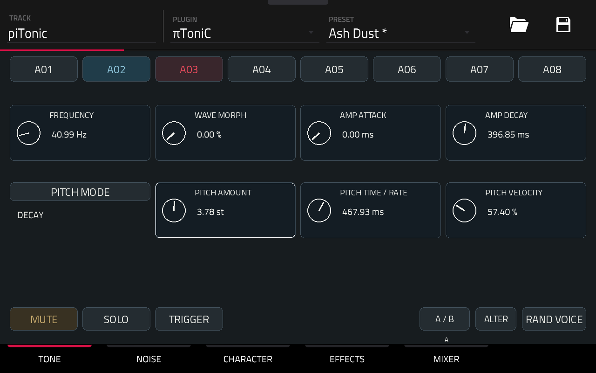
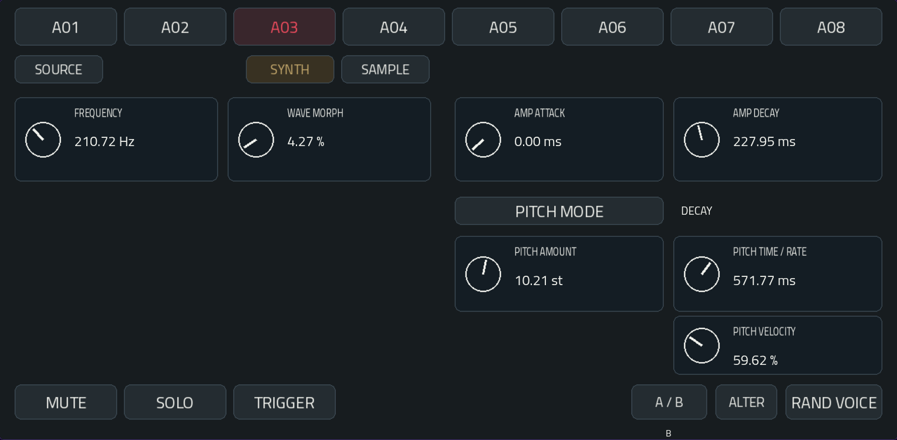
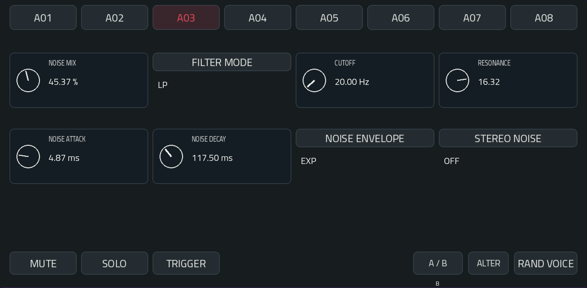
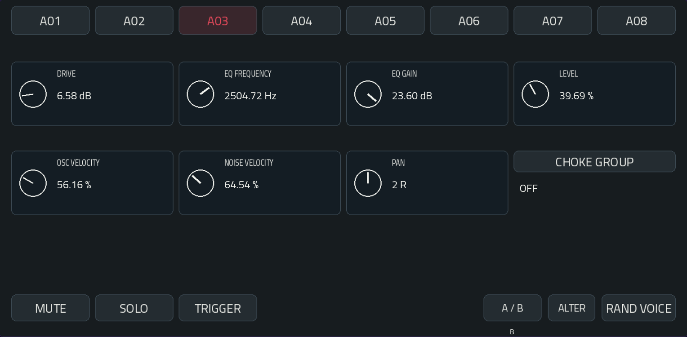
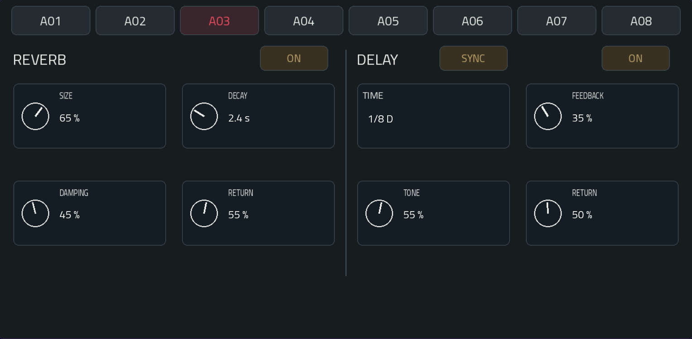
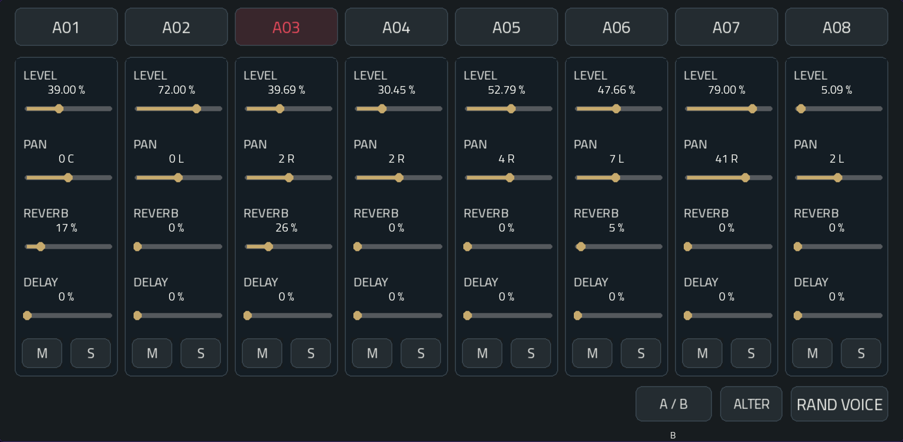
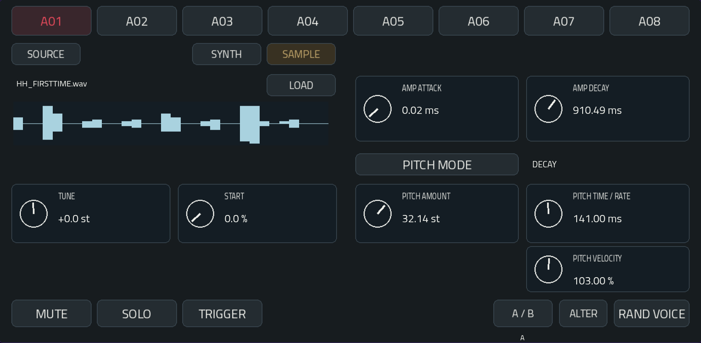

# πToniC — User Manual

A Microtonic-inspired drum machine with eight independent percussion voices.

Shape a hit.  
Build a pattern.  
Give each voice its own space with shared reverb and delay.

Explore **150 converted Patternarium BEST kit presets**, then make them your own.

## 1. Play

**A01–A08** select a voice for editing. MIDI notes **36–43** trigger the eight voices without changing your selection. Notes 0–7 are also accepted as drum-path aliases.

Use the Force's own Step Sequencer. For notes 36–43 on A01–A08:

**SHIFT + STEP SEQUENCER → Scale: Chromatic → Snap to Scale: On.**

Check the starting register. **TRIGGER** previews the selected voice. Envelopes set the sound's duration; releasing the pad does not cut the hit.

The selected voice is red. A thin white outline follows the focused control for the data wheel. An azure pulse marks an accepted trigger; muted voices and voices excluded by Solo do not flash.

A02 is playing: its button pulses azure while A03 remains selected for editing.

## 2. TONE

- **FREQUENCY** tunes the oscillator.
- **WAVE MORPH** moves through sine, triangle, saw and square.
- **AMP ATTACK / DECAY** shape the amplitude envelope.
- **PITCH MODE** selects a decay envelope, sine modulation or random modulation.
- **PITCH AMOUNT** sets the pitch excursion in semitones.
- **PITCH TIME / RATE** sets milliseconds in DECAY mode and Hz in SINE / RANDOM. The effective sine rate is capped at 2,000 Hz.
- **PITCH VELOCITY** makes pitch modulation respond to playing velocity.

## 3. NOISE

**NOISE MIX** balances oscillator and noise.

**FILTER MODE** selects LP, BP or HP. Shape it with **CUTOFF** and **RESONANCE**.

**NOISE ATTACK / DECAY** set the noise envelope. Choose **EXP**, **LINEAR** or **CLAP** with NOISE ENVELOPE.

**STEREO NOISE** uses independent noise sources on the two sides. OFF uses a common source.

## 4. CHARACTER

**DRIVE** adds saturation. **EQ FREQUENCY / GAIN** change the voice's colour.

**LEVEL** sets its volume. **OSC VELOCITY / NOISE VELOCITY** control the two velocity responses. **PAN** places the voice in stereo.

Voices in the same **CHOKE GROUP** cut one another off. Choose OFF to let them ring independently.

## 5. EFFECTS

One shared reverb on the left. One shared delay on the right. Feed them from the MIXER sends; the dry sound stays present. The effects run in parallel.

### Reverb

- **SIZE** changes the reverb network's size.
- **DECAY** sets a nominal decay of 0.2–8 seconds. Filtering and diffusion affect the perceived tail.
- **DAMPING** darkens the tail.
- **RETURN** sets the overall reverb level.

### Delay

**SYNC** follows MPC's tempo. Touch TIME to choose **1/16, 1/8, 1/8 D, 1/4 or 1/2**. D means dotted.

Switch to **FREE** for **20–1,500 ms**.

**FEEDBACK** sets the repeats, up to 90%. **TONE** filters their high frequencies. **RETURN** sets the overall delay level.

The stereo delay crosses its feedback between left and right. Changing TIME moves the read position smoothly and can bend the pitch of existing repeats.

SYNC uses valid host tempo between 20 and 400 BPM; it falls back to 120 BPM before receiving tempo. The buffer covers all offered divisions within that range.

**ON / OFF** fades the effect input and return. The internal tail drains while OFF; quickly re-enabling can reveal the remainder.

## 6. MIXER

Each voice has **LEVEL, PAN, REVERB, DELAY, M and S**.

**REVERB / DELAY** set its two sends, after level and pan. Start with one send, then adjust the effect's RETURN.

**M** silences the voice.

**S** plays only soloed voices. Multiple solos are allowed; Mute takes precedence.

Active toggles are amber. Existing effect tails may continue after muting a voice.

All factory sends start at zero: raise a send to hear an effect. Networks with no input or tail skip their audio processing.

## 7. Explore

**A / B** compares two sound states for the selected voice.

**ALTER** makes a small variation.

**RAND VOICE** creates a new timbre.

These preserve LEVEL, PAN, MUTE, SOLO, CHOKE, sends and shared effects. Sends are mix settings shared by both A/B sound states.

## 8. Q-Links

Left to right on the Force's eight physical encoders:

| Page | Controls |
| --- | --- |
| TONE | Frequency · Wave Morph · Amp Attack · Amp Decay · Pitch Amount · Pitch Time / Rate · Pitch Velocity · unused |
| NOISE | Noise Mix · Cutoff · Resonance · Noise Attack · Noise Decay · unused · unused · unused |
| CHARACTER | Drive · EQ Frequency · EQ Gain · Level · Osc Velocity · Noise Velocity · Pan · unused |
| EFFECTS | Reverb Size · Decay · Damping · Return · Delay Time · Feedback · Tone · Return |
| MIXER | Level A01 through A08 |

TONE, NOISE and CHARACTER follow the selected voice. EFFECTS controls the shared processors; its TIME encoder follows SYNC / FREE. MIXER always controls all eight levels. Use touch and the data wheel for sends.

## 9. Presets and projects

The native **PRESET** menu lists 150 converted Patternarium BEST kits. Selecting a kit recalls all eight voices and their A/B sound states. The first program loads when you insert the instrument.

Use MPC's native preset save function to keep your own kits, including sends and effects. A project stores the selected program and your edits. Audio tails are transient and are cleared on state recall.

Legacy πToniC PT1 states load with zero sends and default effects. Older binaries cannot load new effect-enriched states.

The kits are adapted parameter recipes for πToniC's own engine. They do not reproduce Microtonic's sound exactly. Source credits accompany the bank.

## SAMPLE source — 1.0.1

In **TONE**, select **SYNTH** or **SAMPLE** for each voice. **LOAD** opens the WAV browser. Use **USER / SD**, **DRIVES**, **UP**, **PREVIOUS** and **NEXT**, then tap a file. **CANCEL** closes the panel. The browser displays up to 256 entries per directory; split larger collections into subfolders.

Supported WAV: mono/stereo PCM 16/24/32-bit and float32, 8–192 kHz, up to ten seconds per voice. Files and static waveform peaks are prepared by a background worker. Missing, unsupported or oversized files are reported; the sample source remains silent.

**TUNE** adjusts pitch ±48 semitones, with 0 at original speed. **START** sets the starting position. Pitch changes playback duration; there is no time-stretch or looping. Each note retriggers the voice. AMP and PITCH MODULATION, noise mixing, character processing and effect sends remain available.

TONE's seven Q-Links control TUNE, START, AMP ATTACK, AMP DECAY, PITCH AMOUNT, PITCH TIME/RATE and PITCH VELOCITY. In SYNTH, the first two return to FREQUENCY and WAVE MORPH. A/B stores separate TUNE/START settings; source and file are shared. ALTER and RAND VOICE preserve the file/source while varying sound settings.

**Projects and presets retain original sample paths, not embedded audio.** Keep files at the same locations on available media. Collecting samples beside saved presets is deferred. Preserve original project copies: older binaries cannot read the new sample state extension.

Tested on Force Gen1 by the author during a musical session. The release package is rebuilt from that candidate; this is separate from a formal install/uninstall qualification. Gen2 hardware is not qualified.

The sample overview shows cached, display-normalized positive/negative peaks. Normal duration/stereo/Ready lines are hidden; load errors use the filename line.
